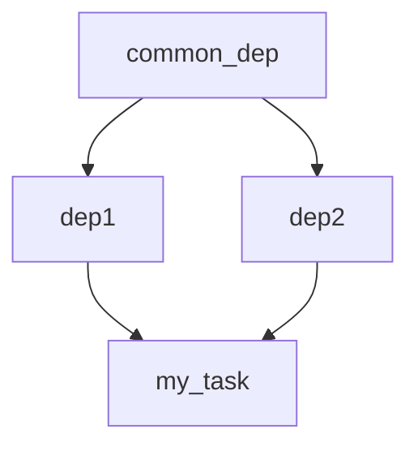

# State and dependencies

Tasks can ask for things they need, such as a database client or the
current message, instead of building them. SynTasks resolves them before
each run, in the same style as FastAPI's `Depends`. Dependency injection is
vendored from [taskiq-dependencies](https://github.com/taskiq-python/taskiq-dependencies).

## State: things built once per worker

`SynTasksState` lives as long as the worker process. Fill it in a startup
event and read it from tasks through the `Context`:

```python
from typing import Annotated

from syntasks import Context, Redis, SynTasks, SynTasksDepends, SynTasksEvents, SynTasksState

app = SynTasks()


@app.on_event(SynTasksEvents.WORKER_STARTUP)
async def startup(state: SynTasksState) -> None:
    state.cache = Redis.from_url("redis://localhost/1")  # once per worker process


@app.on_event(SynTasksEvents.WORKER_SHUTDOWN)
async def shutdown(state: SynTasksState) -> None:
    await state.cache.close()


@app.task
async def get_val(key: str, context: Annotated[Context, SynTasksDepends()]) -> str | None:
    value = await context.state.cache.get(key)
    return None if value is None else value.decode()
```

| Event | Runs when |
| --- | --- |
| `WORKER_STARTUP`, `WORKER_SHUTDOWN` | a worker process starts or stops |
| `CLIENT_STARTUP`, `CLIENT_SHUTDOWN` | your own program calls `app.startup()` / `app.shutdown()` |

`app.add_event_handler(event, handler)` does the same without a decorator.

## Dependencies

`context.state.cache` has no type, so your editor can't help. A dependency
function gives it one:

```python
def cache(context: Annotated[Context, SynTasksDepends()]) -> Redis:
    return context.state.cache


@app.task
async def set_val(key: str, value: str, redis: Annotated[Redis, SynTasksDepends(cache)]) -> None:
    await redis.set(key, value)
```

A parameter is a dependency when its default, or its `Annotated` metadata,
is `SynTasksDepends(...)` (`Depends` is the same thing). Dependencies can
have dependencies of their own; the graph is built once when the task is
registered.

Both spellings work:

```python
async def task_a(redis: Annotated[Redis, SynTasksDepends(cache)]) -> None: ...
async def task_b(redis: Redis = SynTasksDepends(cache)) -> None: ...
```

### Evaluated once per run

Within one run, each dependency is evaluated once and shared:

```python
def common_dep() -> int:
    return random.randint(1, 10)


def dep1(cd: Annotated[int, SynTasksDepends(common_dep)]) -> int:
    return cd + 1


def dep2(cd: Annotated[int, SynTasksDepends(common_dep)]) -> int:
    return cd + 2


@app.task
def my_task(
    d1: Annotated[int, SynTasksDepends(dep1)],
    d2: Annotated[int, SynTasksDepends(dep2)],
) -> int:
    return d1 + d2  # dep1 and dep2 got the same common_dep value
```



`SynTasksDepends(common_dep, use_cache=False)` gives that parameter its own
fresh value instead.

### Classes

A class is a dependency too, and its `__init__` can ask for others. When the
type hint is the class itself, `SynTasksDepends()` needs no argument:

```python
async def db_connection() -> str:
    return "a connection"


class UsersDAO:
    def __init__(self, conn: Annotated[str, SynTasksDepends(db_connection)]) -> None:
        self.conn = conn


@app.task
async def list_users(dao: Annotated[UsersDAO, SynTasksDepends()]) -> None: ...
```

Generic classes work: `Annotated[Repo[User], SynTasksDepends()]` resolves the
`T` in `Repo.__init__(self, model: Annotated[T, SynTasksDepends()])` to
`User`.

### Setup and teardown

A generator (sync or async) runs its code before `yield` before the task,
and the rest after it:

```python
async def transaction(db: Annotated[DB, SynTasksDepends(get_db)]) -> AsyncGenerator[Transaction, None]:
    tx = await db.begin()
    try:
        yield tx
    except Exception:
        await tx.rollback()  # the task raised
        return
    await tx.commit()
```

The exception the task raised is thrown into the generator at `yield`, so
it can commit only on success. The run still fails with that error; don't
re-raise it (that only logs it a second time).

## Built in

| Ask for | Get |
| --- | --- |
| `Context` | the message being run, the broker, and `context.state` |
| `SynTasksState` | the worker's state |
| `Deadline` | time left before the soft and hard timeouts ([Limits](limits.md)) |
| `ScheduleInfo` | schedule id, fire time and run number, for runs a schedule fired ([Scheduling](scheduling.md)) |
| `ProgressTracker[T]` | reports progress ([below](#progress)) |

To add your own first-level values (for libraries), call
`app.add_dependency_context({SomeType: value})`. In tests,
`app.dependency_overrides[get_db] = fake_db` swaps a dependency.

## Progress

```python
from syntasks.depends.progress_tracker import ProgressTracker, TaskState


@app.task
async def import_rows(progress: Annotated[ProgressTracker[str], SynTasksDepends()]) -> None:
    for i in range(10):
        ...
        await progress.set_progress(TaskState.STARTED, meta=f"{(i + 1) * 10}%")
```

Read it from the handle `kiq` returned:

```python
task = await import_rows.kiq()
async for update in task.watch_progress(timeout=60):   # pushed as it changes
    print(update.state, update.meta)

progress = await task.get_progress()                     # or the latest, once
```

`state` is a `TaskState` (`STARTED`, `SUCCESS`, `FAILURE`, `RETRY`) or any
string; `meta` is anything the serializer can encode. `set_progress`
without `meta` keeps the previous `meta`.
